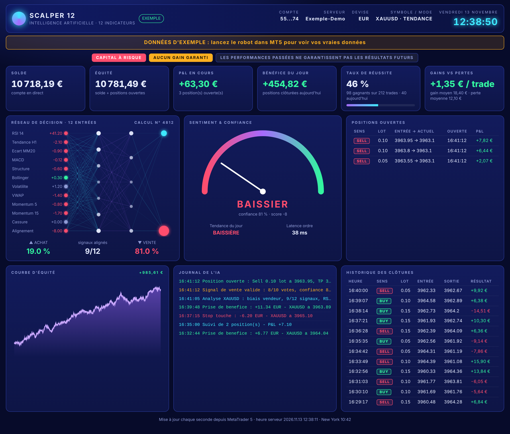

# Tableau de bord en direct (style de la vidéo)

Page web néon qui affiche en direct ce que fait le robot `mt5/Scalper12Indicators.mq5` (version 3 ou plus) :
- en-tête : compte, serveur, devise, horloge ;
- avertissements « Capital à risque » et « Aucun gain garanti » ;
- cartes : solde, équité, P&L en cours, bénéfice du jour, taux de réussite, gains comparés aux pertes ;
- réseau de décision animé : les 12 entrées, la décision Achat %/Vente %, le numéro de calcul et les signaux alignés ;
- jauge « Sentiment & confiance », tendance du jour et latence des ordres ;
- positions ouvertes, journal de l'IA, courbe d'équité et historique des clôtures.



## Fonctionnement

Le robot écrit son état chaque seconde dans `Scalper12_status.json`, dans le dossier commun de MetaTrader (`%APPDATA%\MetaQuotes\Terminal\Common\Files`). `server.py` le lit et affiche la page. Il n'utilise que Python, sans rien à installer.

## Utilisation (sur le PC où tourne MT5)

1. Installer Python 3 (python.org), en cochant « Add Python to PATH ».
2. Lancer le robot `Scalper12Indicators` dans MT5, avec le paramètre `ExportDashboard = true` (valeur par défaut).
3. Dans ce dossier `dashboard`, lancer :
   ```
   python server.py
   ```
4. Ouvrir **http://localhost:8765** dans le navigateur.

Sur le téléphone, même Wi-Fi que le PC : lancer `python server.py --lan` et ouvrir l'adresse affichée. Windows peut demander d'autoriser l'accès réseau.

Aperçu sans MT5 : `python server.py --demo` affiche des **données d'exemple**, signalées par un bandeau orange.

Si le fichier n'est pas trouvé automatiquement : `python server.py --file "C:\chemin\vers\Scalper12_status.json"`.
