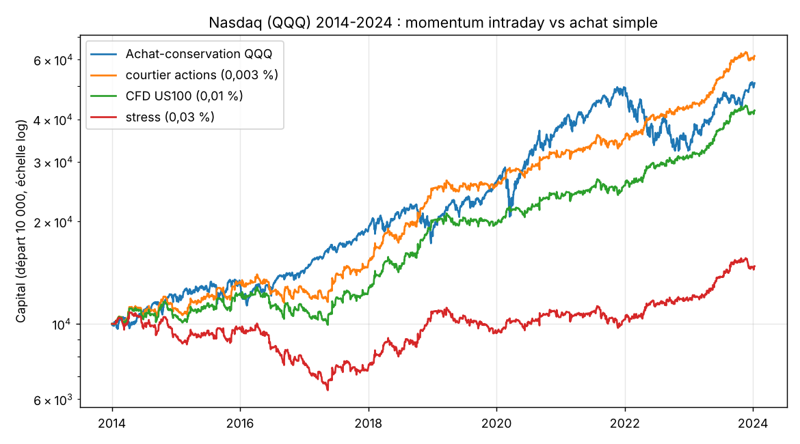

# Day trading sur le Nasdaq 100 (QQQ)

Stratégie testée : « Beat the Market » de Zarattini, Aziz et Barbon (2024). C'est un momentum intraday publié avec des règles précises : on achète quand le prix sort par le haut de la « zone de bruit » autour de l'ouverture, on vend à découvert quand il sort par le bas, on suit avec un stop VWAP et on ferme tout à 16h.

Données : QQQ en bougies 1 minute, de janvier 2014 à janvier 2024 (2 508 séances, jeu Hugging Face `Maxim37/timeseries-1m-QQQ-10y`), séance régulière uniquement.

```
python3 qqq_intraday_momentum.py qqq.parquet [graphique.png]
```

Règles de l'article, sans aucune optimisation : zone de bruit sur 14 jours, décision toutes les 30 minutes, levier = min(4, 2 % / volatilité quotidienne sur 14 jours). Seule différence, plus prudente que l'article : les ordres sont exécutés à l'ouverture de la minute suivante.

## Résultats

| Version | CAGR | Max DD | Sharpe | 2014–2018 | 2019–2024 |
|---|---|---|---|---|---|
| Achat-conservation QQQ | +17,7 % | -35 % | 0,87 | +13,3 % | +22,2 % |
| Momentum, frais courtier actions (0,003 %) | +19,9 % | -18 % | 1,31 | +20,0 % | +19,8 % |
| **Momentum, frais CFD US100 (0,01 %)** | **+15,5 %** | **-23 %** | **1,06** | +14,9 % | +16,2 % |
| Momentum, frais ×3 (0,03 %) | +4,0 % | -41 % | 0,34 | +1,5 % | +6,5 % |

- Environ 1 trade par jour, 40 % de trades gagnants, gain moyen 1,9 fois la perte moyenne, levier moyen 2,2.
- Les longs et les shorts sont tous les deux gagnants.
- Par année avec frais CFD : 2014 +6 %, 2015 +16 %, 2016 -9 %, 2017 +11 %, 2018 +62 %, 2019 -2 %, 2020 +19 %, 2021 +9 %, 2022 +21 % (QQQ -33 %), 2023 +35 %.
- Sensibilité : les 7 variantes testées (fenêtre de 10 à 20 jours, décision toutes les 15 à 60 minutes, bande ×0,8 à ×1,5) restent entre +12 et +16 %/an, avec un Sharpe de 0,85 à 1,10.

## Conclusion

C'est la seule stratégie de day trading de tout ce dépôt qui tient : sur les deux périodes, avec tous les réglages, longs comme shorts. Son atout principal, c'est une perte maximale bien plus faible que l'indice et des gains les années de krach (2018, 2022).

Limites :
- Les frais décident de tout. Il faut un courtier à frais très bas : actions avec commission par action, futures Micro Nasdaq, ou CFD US100 à spread serré. Avec des frais trois fois plus élevés, il ne reste presque rien.
- Le levier moyen est de 2,2 et monte jusqu'à 4.
- Données jusqu'à janvier 2024 seulement, sur une période qui recoupe celle de l'article (2007–2024). Il faut une période de test en démo avant d'y mettre de l'argent.
- Il fait moins bien que l'indice les années de forte hausse (2019 : -2 % contre +39 %).


