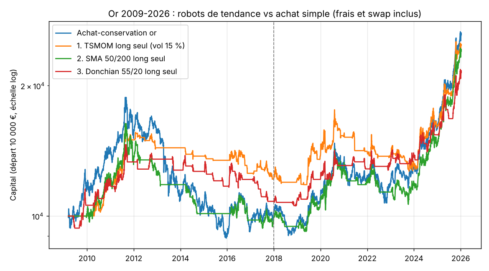

# Day trading sur l'or (XAUUSD)

Quatre stratégies de day trading publiées, testées sur 17 ans de bougies 5 minutes (mars 2009 → janvier 2026, 4 281 séances). Toutes les positions sont fermées à 16h55, heure de New York, donc sans swap de nuit.

Lancer :

```
python3 prepare_data.py              # télécharge les données minute HistData (miroir Hugging Face), ~400 Mo
python3 xau_daytrade_backtest.py
```

## Méthode

- Les paramètres par défaut viennent des articles ou des réglages courants. Ils ont été fixés avant de voir les résultats. Une grille de sensibilité autour d'eux est publiée séparément.
- Exécution : un signal calculé sur une clôture est exécuté à l'ouverture de la bougie suivante. Si le stop et l'objectif sont touchés dans la même bougie, on compte le stop.
- Frais aller-retour (spread + glissement) : 0,02 % du prix par défaut (≈ 0,80 $ à 3 900 $, compte CFD standard), 0,007 % pour un compte ECN à spread brut (≈ 0,25 $), 0,06 % en scénario pessimiste.
- Taille : notionnel = min(4, 1 % / volatilité journalière de l'or sur 20 jours), soit environ 1× le capital.
- Période 1 : 2009–2017. Période 2 : 2018–2026.
- Correction des données : HistData annonce des heures en EST sans heure d'été, mais la pause quotidienne montre qu'elles suivent l'heure d'été européenne. `prepare_data.py` corrige ce décalage, sinon toutes les heures de session seraient fausses d'une heure l'été.

## Stratégies

| | Stratégie | Source |
|---|---|---|
| A | ORB première bougie à 08h20 (ouverture COMEX) : sens de la 1re bougie de 5 min, stop à l'autre extrémité, objectif 10R, sinon sortie à la clôture | Zarattini & Aziz 2023 |
| B | Cassure du range asiatique (18h → 03h) entre 03h et 11h, stop au milieu du range, objectif 2R | pratique courante sur l'or |
| C | Noise boundary : achat au-dessus de ouverture×(1+σ), vente en dessous, vérifié toutes les 30 min | Zarattini, Aziz & Barbon 2024, « Beat the Market » |
| D | Momentum intraday : le rendement depuis 18h prédit la fenêtre 13h00–13h30 (avant le settlement COMEX) | Gao et al. 2018, Baltussen et al. 2021 |

## Résultats

Sharpe annualisé :

| Stratégie | Gagnants | Sans frais | ECN 0,007 % | Standard 0,02 % | Pessimiste 0,06 % | CAGR (standard) | Max DD (standard) |
|---|---|---|---|---|---|---|---|
| Achat-conservation or | — | 0,68 | — | — | — | +9,9 % | -45 % |
| A. ORB 08h20 | 16 % | 0,77 | 0,41 | -0,26 | -2,31 | -1,7 % | -32 % |
| B. Range asiatique | 38 % | 0,58 | 0,31 | -0,19 | -1,72 | -1,7 % | -42 % |
| C. Noise boundary | 31 % | 0,30 | -0,04 | -0,67 | -2,52 | -5,9 % | -67 % |
| D. Momentum 13h | 44 % | 0,82 | 0,02 | -1,48 | -6,01 | -3,9 % | -50 % |

Avec des frais ECN, par période :

| Stratégie | Sharpe 2009–2017 | Sharpe 2018–2026 | CAGR total | Longs seuls | Shorts seuls |
|---|---|---|---|---|---|
| A. ORB 08h20 | +0,32 | +0,50 | +2,3 %/an | -0,20 | +0,68 |
| B. Range asiatique | +0,35 | +0,27 | +2,1 %/an | -0,16 | +0,58 |
| C. Noise boundary | -0,04 | -0,05 | -0,7 %/an | -0,02 | -0,04 |
| D. Momentum 13h | +0,59 | -0,74 | +0,0 %/an | -0,11 | +0,13 |

Sensibilité, avec les frais standard :

- A, 27 réglages : aucun n'est positif sur 2018–2026. Le meilleur réglage de 2009–2017 (Sharpe +0,54) tombe à -0,65 ensuite.
- B, 18 réglages : 11 sont positifs sur 2018–2026, médiane +0,02. Le meilleur réglage de 2009–2017 passe de +0,67 à +0,24.
- C (27 réglages) et D (8 réglages) : aucun n'est positif, sur aucune des deux périodes.

## Conclusion

Aucune de ces stratégies ne mérite d'y mettre du capital.

- Les avantages bruts existent mais sont minuscules : 0,5 à 1 point de base par trade. Le spread d'un compte CFD standard suffit à les annuler.
- Sur un compte ECN, A et B restent légèrement positives sur les deux périodes, mais rapportent environ 2 %/an pour des drawdowns de 15 à 30 %. C'est bien moins que garder simplement de l'or. Leur gain vient presque entièrement des shorts, ce qui demande d'autres tests avant d'en faire une stratégie.
- Le momentum intraday (D) marchait sur 2009–2017 et s'est inversé ensuite : c'est le profil type d'un effet qui disparaît une fois publié.
- Le taux de réussite ne dit rien de la rentabilité : l'ORB gagne 16 % de ses trades et c'est la moins mauvaise après frais. Le momentum en gagne 44 % et c'est la pire.

Ce qui a fonctionné dans ce dépôt, ce sont les stratégies de tendance en swing (voir `../hedge_backtest`, TSMOM), pas le day trading.

Limites : prix bid HistData uniquement, glissement modélisé par un coût fixe, pas d'impact des annonces macro sur le spread. Ces limites jouent toutes contre les stratégies, pas en leur faveur.

## Le scalper « HFT STR – Neural Core » vu sur TikTok (`python3 scalper_backtest.py`)

Une vidéo montre un robot MT5 (courtier Xlence) qui scalpe XAUUSD avec 78 à 88 % de trades gagnants. Son tableau de bord combine 12 indicateurs : RSI 14, tendance H1, écart à la MM, MACD, structure, Bollinger, volatilité, VWAP, momentum 5 et 15, cassure, alignement. Il trade quand « 8/12 signaux » sont alignés.

Reconstruction : chaque indicateur directionnel vote +1, -1 ou 0 sur des bougies de 5 minutes, soit 10 votes (la volatilité et l'alignement ne donnent pas de sens). On entre quand au moins 8 votes vont dans le même sens. Sorties de scalper : objectif 0,5 ATR, stop 1,5 ATR, 1 heure maximum. Fenêtre de 03h00 à 16h55 (New York). On teste aussi la lecture inverse, qui joue contre les signaux.

| Lecture | Frais | Trades/jour | Gagnants | PF | CAGR (1x) | Sharpe 09-17 | Sharpe 18-26 |
|---|---|---|---|---|---|---|---|
| Suivre les signaux | sans frais | 21 | 71 % | 0,88 | -21 % | -4,4 | -2,6 |
| Suivre les signaux | ECN | 21 | 71 % | 0,69 | -46 % | -10,0 | -9,0 |
| Contre les signaux | sans frais | 20 | 73 % | 0,94 | -10 % | -2,0 | -1,1 |
| Contre les signaux | ECN | 20 | 73 % | 0,74 | -37 % | -7,7 | -6,9 |

Sur 108 réglages (seuil 6/8/10 votes, objectif 0,3/0,5/1 ATR, stop 0,5/1/2 ATR, durée 30 min ou 2 h, les deux lectures), aucun n'est positif, sur aucune période, même avec des frais ECN. Le réglage au plus fort taux de réussite gagne 85 % de ses trades, avec un Sharpe d'environ -11.

Conclusion : ce scalper gagne souvent mais perd de l'argent, et il perd même sans aucun frais. Son taux de réussite élevé vient seulement d'un objectif petit et d'un stop large. Les résultats de la vidéo (40 trades sur une journée) relèvent de la chance ou de la sélection, et ne montrent pas un avantage réel.

## Robots de tendance sur l'or (`python3 gold_trend_backtest.py [données] [graphique.png]`)

Ces robots gardent leurs positions quelques jours à quelques semaines. Ils sont testés sur les clôtures quotidiennes de 2009 à 2026, avec 0,02 % de frais par transaction et un swap CFD de 0,01 %/jour sur toute position tenue. Les paramètres sont des valeurs classiques, fixées à l'avance.

| Robot | CAGR | Max DD | Sharpe | Pire année | Temps investi | CAGR 09-17 | CAGR 18-26 | CAGR frais ×3 |
|---|---|---|---|---|---|---|---|---|
| Achat-conservation or (CFD) | +6,0 % | -53 % | 0,44 | -31 % | 100 % | +0,3 % | +12,6 % | -1,5 % |
| **TSMOM long seul, vol 15 %** | **+5,9 %** | **-28 %** | **0,58** | **-8 %** | 44 % | +2,6 % | +9,3 % | +2,1 % |
| SMA 50/200 long seul | +5,7 % | -44 % | 0,50 | -14 % | 63 % | -0,1 % | +11,8 % | +0,6 % |
| Donchian 55/20 long seul | +4,8 % | -28 % | 0,50 | -11 % | 38 % | +0,9 % | +9,1 % | +1,7 % |
| TSMOM long/short | +4,4 % | -42 % | 0,39 | -14 % | 65 % | +1,5 % | +7,3 % | -1,2 % |
| Donchian 55/20 long/short | +0,3 % | -54 % | 0,08 | -21 % | 60 % | -3,4 % | +4,3 % | -4,4 % |

Robustesse de TSMOM long seul : les 15 réglages testés (fenêtres de 1 à 12 mois, volatilité cible de 10 à 20 %) sont tous positifs, avec un Sharpe de 0,38 à 0,62.

Sans swap, c'est-à-dire en tradant via des futures ou un ETF plutôt qu'un CFD : achat-conservation +9,9 %/an (max DD -45 %), TSMOM long seul +7,8 %/an (max DD -25 %).

Conclusion : le seul robot qui tient est TSMOM long seul. Il ne gagne pas plus que de garder de l'or, mais il divise par deux la perte maximale (-28 % contre -53 %) et sa pire année est à -8 % au lieu de -31 %. Il reste dehors pendant les baisses (2013, 2015), puis rate une partie des rebonds. Il a fini 7 années sur 17 en positif : les gains arrivent en quelques grosses années (2010, 2011, 2019, 2024, 2025). Le swap CFD coûte environ 3,5 %/an à toute position longue sur l'or.



## Nyao Scalper, le meilleur scalper open source sur l'or (`python3 nyao_rebuild_backtest.py`)

[elrizwiraswara/nyao_scalper_mt5](https://github.com/elrizwiraswara/nyao_scalper_mt5) : 248 étoiles, code MQL5 complet, rapports de backtest publiés. Profil par défaut selon l'auteur (testeur MT5, ticks réels en 2026) : 2022 -5,3 %, 2023 -9,0 %, 2024 +0,9 %, 2025 +65,3 %, janvier–septembre 2026 +93,8 %. L'auteur ne publie rien avant 2022.

Reconstruction indépendante des règles principales, lues dans le code source : score de tendance à 4 composantes, filtre de tendance journalière (EMA50 à ±0,5 %), stop à 20 $, paliers tous les 20 $, stop suiveur, verrouillage du profit dès +15 $, sortie quand la tendance se retourne. Simplifications : une position à la fois au lieu de deux, sans filtre des annonces ni pauses. Testée sur 2009–2026.

| | 2009–2021 (jamais publié par l'auteur) | 2022 | 2023 | 2024 | 2025 |
|---|---|---|---|---|---|
| Auteur (MT5) | — | -5,3 % | -9,0 % | +0,9 % | +65,3 % |
| Reconstruction, stop 20 $, frais 0,30 $ | **-66 % au total, 2 années positives sur 13** | -0,6 % | -2,9 % | +12,4 % | +48,9 % |
| Reconstruction, stop 0,55 % du prix | -383 % au total, 1 année positive sur 13 | -5,1 % | -19,1 % | +11,2 % | +47,6 % |

Sur 2022–2025, la reconstruction retrouve le profil de l'auteur : des pertes en 2022–2023, puis des gains concentrés en 2024–2025. Sur 2009–2021, elle perd 11 années sur 13. Sur 17 ans, le gain moyen par trade est nul (PF 1,00) et 17 % des trades sont gagnants.

Conclusion : les gains publiés viennent de la hausse exceptionnelle de l'or en 2025–2026 (+59 % en 2025), pas d'un avantage durable. Le robot a été mis au point sur la période même où il est testé. Sur les 13 années qu'il n'a jamais vues, il perd.
